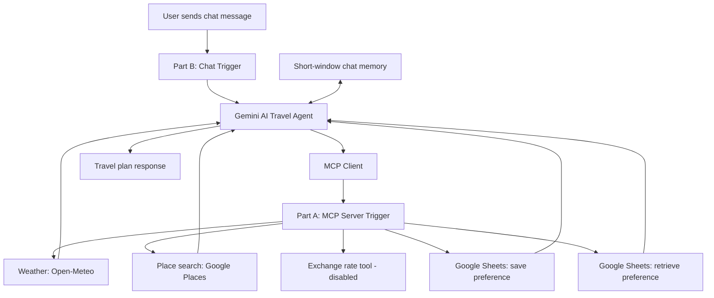

# Personalized AI Travel Assistant with MCP

A two-workflow n8n project that combines a conversational travel-planning agent with an MCP tool server. The chat agent uses Google Gemini, short-window chat memory, and tools for weather, place search, currency conversion, and saving/retrieving long-term travel preferences.

> **Project type:** n8n + MCP + Gemini + Google Sheets + external APIs. The two JSON exports are separate parts of one project: Part A exposes tools through an MCP server trigger; Part B is the chat-facing agent that connects to that server.

## What it does

- Lets a user request a travel plan through an n8n chat trigger.
- Uses Google Gemini as the conversational model.
- Uses a connected MCP server to access tools exposed by Part A.
- Retrieves saved preferences by `user_id` when available.
- Can save budget, hotel type, transport preference, dietary needs, and preferred activities to Google Sheets.
- Includes a current-weather tool using Open-Meteo.
- Includes a place-search tool using Google Places Text Search.
- Includes an exchange-rate tool, but it is **disabled in the supplied export** and must be configured and tested before use.
- Uses a short-window memory node keyed by the chat session ID.

The Part B prompt asks the assistant to return recommended dates, weather summary, hotel options, places to visit, restaurant suggestions, packing tips, and a short travel tip. Actual coverage depends on tool results and the user's request.

## Architecture



Editable source: [`docs/workflow-diagram.mmd`](docs/workflow-diagram.mmd)

## Technology stack

- n8n
- Model Context Protocol (MCP)
- Google Gemini (`models/gemini-3.5-flash-lite` in the supplied export)
- Open-Meteo forecast API
- Google Places Text Search API
- Google Sheets
- Frankfurter-style exchange-rate endpoint placeholder (tool currently disabled)
- n8n Simple Memory

## Business use case

Travel planning can require switching between weather forecasts, place discovery, currency information, and personal preference notes. This assistant brings those tasks into a single conversational flow and can reuse preferences such as budget, accommodation type, transport, dietary needs, and preferred activities.

Potential users include travel consultants, small travel agencies, and travelers who want a repeatable planning assistant. This is a prototype, not a booking engine: the supplied tools search places and weather but do not book hotels or restaurants.

## Setup guide

### Requirements

- An n8n instance with LangChain/MCP nodes supported.
- Google Gemini API credential.
- Google Sheets OAuth credential and a preferences spreadsheet.
- Google Maps Platform API key with Places API access and billing/configuration as required.
- An n8n MCP server endpoint reachable by the Part B workflow.
- Optional: exchange-rate provider configured before enabling the exchange tool.

### Configure Part A: MCP tool server

1. Import `workflow/travel-assistant-mcp-server.template.json`.
2. Reconnect your own Google Sheets credentials in `save_preference` and `get_preference`.
3. Replace the spreadsheet ID and sheet name placeholders with your own preference store.
4. Ensure the sheet headers match: `user_id`, `budget`, `hotel_type`, `transport`, `dietary`, `activities`.
5. Add your own Google Maps API key to `search_places`. Restrict the key to the required API and appropriate application restrictions.
6. Review the `get_weather` parameters and test a known latitude/longitude.
7. The `get_exchange_rate` tool is disabled in the supplied workflow. Configure a trusted endpoint, validate response format, and enable only after testing.
8. Activate the MCP server workflow and copy its current MCP endpoint from n8n.

### Configure Part B: chat agent

1. Import `workflow/personalized-travel-assistant-client.template.json`.
2. Reconnect your Google Gemini credential.
3. Replace the MCP Client endpoint placeholder with the endpoint from your Part A workflow.
4. Confirm the MCP client can discover the tools from Part A.
5. Test the chat with a non-sensitive sample request and a stable `user_id`.
6. Test preference retrieval and saving with a dedicated test spreadsheet row.
7. Verify that tool failures result in a useful fallback response rather than fabricated weather, prices, or place data.

### Sample request

```text
Plan a 3-day mid-range trip to Sajek Valley for two people.
I prefer a comfortable hotel, local food, and scenic viewpoints.
My user_id is demo-user-001.
```

### Example preference record

```json
{
  "user_id": "demo-user-001",
  "budget": "mid-range",
  "hotel_type": "comfortable hotel",
  "transport": "private car",
  "dietary": "no restrictions",
  "activities": "scenic viewpoints, local food"
}
```

This is an illustrative record shape, not a verified output from the supplied workflow.

## Output and evidence

Capture real test evidence after configuring the two workflows:

1. Part A MCP server showing the tools available.
2. Part B chat run with weather and place-search results.
3. Preference retrieval for a known test user.
4. Preference save/update in the test Google Sheet.
5. A graceful response when a tool fails.
6. The exchange-rate tool after it has been configured and enabled, if included in the demo.

Do not publish API keys, MCP endpoint URLs, spreadsheet IDs, account identifiers, or personal preference data. Use fake user IDs and sanitized screenshots. See [`screenshots/README.md`](screenshots/README.md).

## Business impact measurement

Potential benefits include reducing context switching, reusing travel preferences, and accelerating the first draft of an itinerary. No measured time savings, cost savings, or accuracy results were supplied, so this repository makes no numerical claims.

For a small pilot, measure:
- time to produce a first itinerary manually vs. with the assistant;
- percentage of recommendations with verifiable source/tool data;
- preference retrieval/save success rate;
- tool failure rate and graceful fallback rate;
- number of corrections needed before a human accepts the itinerary;
- whether suggested places match stated budget, location, and interests.

## Review findings and fixes before publishing

These findings are based on inspection of the supplied JSON exports, not a live execution.

1. **Security: an API key is embedded in Part A.** The public template replaces it with a placeholder. If the embedded key is real, revoke/rotate it immediately and review its usage. Do not commit it to GitHub.
2. **Google Sheets identifiers are embedded.** The public template replaces the spreadsheet ID and cached URLs. Use your own sheet and credentials.
3. **Exchange-rate tool is disabled.** Part A has a `get_exchange_rate` node marked disabled. The template keeps it disabled; configure and test it before enabling.
4. **Dynamic URL risk in exchange-rate node.** The original URL is supplied through an AI-generated parameter. Prefer a fixed trusted endpoint and allowlisted parameters to avoid arbitrary URL requests.
5. **MCP endpoint coupling.** Part B points to a specific n8n Cloud MCP endpoint. The template replaces it with a placeholder; update it after importing Part A.
6. **Preference upsert behavior:** `save_preference` is configured as `appendOrUpdate`, but `matchingColumns` is empty in the export. Configure `user_id` as the matching column so an existing user's preferences update rather than duplicate rows.
7. **Weather tool output:** the tool requests `current_weather=true`; ensure the returned fields meet the agent's output needs and clearly communicate the forecast scope.
8. **Google Places API usage:** confirm the API is enabled, key restricted, and response errors handled. The workflow should not present failed or empty search results as verified recommendations.
9. **Memory/session handling:** Simple Memory uses `sessionId` as a custom key. Verify chat events always supply `sessionId`; otherwise session continuity may fail.
10. **Prompt promises exceed tool coverage:** the agent is instructed to provide recommended dates and 2–3 hotels/restaurants, but Part A's place-search tool is a generic text search and does not book or guarantee availability. Make limitations explicit and verify results.
11. **No actual execution evidence supplied:** screenshots or metrics must come from real test runs.

## Repository structure

```text
.
├── README.md
├── workflow/
│   ├── travel-assistant-mcp-server.template.json
│   └── personalized-travel-assistant-client.template.json
├── docs/
│   ├── workflow-diagram.mmd
│   ├── test-plan.md
│   └── demo-script.md
├── examples/
│   └── sample-travel-request.md
└── screenshots/
    └── README.md
```

## License

Choose a license only after confirming that the assignment, prompts, and any included data may be published. Never commit credentials, private endpoints, or personal preference records.
